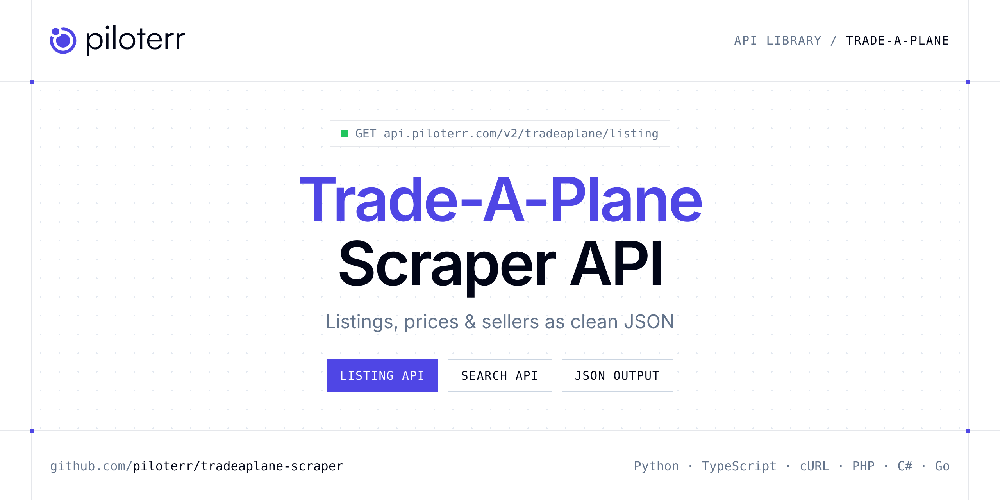

<p align="center">
  <a href="https://www.piloterr.com"></a>
</p>

# Trade-A-Plane Scraper API

[](https://discord.gg/CFj3ph8aHU) [](https://app.piloterr.com) [](https://app.piloterr.com/openapi) [](LICENSE)

The **Piloterr Trade-A-Plane Scraper API** lets you extract public data from Trade-A-Plane as **clean, structured JSON** — no proxies, headless browsers or HTML parsing to maintain. Endpoints available in production:

- **Trade-A-Plane Listing API** — Read one Trade-A-Plane aircraft listing from its URL.
- **Trade-A-Plane Search API** — Search Trade-A-Plane aircraft listings by keyword and page the results.

Use it for listing monitoring, price benchmarks, stock sourcing or market analytics on second-hand and vehicle marketplaces.

| Endpoint | Path | Credits | What you get |
|---|---|---|---|
| [Trade-A-Plane Listing API](#trade-a-plane-listing-api) | `/v2/tradeaplane/listing` | 2 | Read one Trade-A-Plane aircraft listing from its URL. You get the asking price, the airframe details, and the seller. |
| [Trade-A-Plane Search API](#trade-a-plane-search-api) | `/v2/tradeaplane/search` | 2 | Search Trade-A-Plane aircraft listings by keyword and page the results. Cards include title, price, and the listing link. |

## Table of contents

- [How it works](#how-it-works)
- [Trade-A-Plane Listing API](#trade-a-plane-listing-api)
- [Trade-A-Plane Search API](#trade-a-plane-search-api)
- [Code examples in other languages](#code-examples-in-other-languages)
- [Practical use cases](#practical-use-cases)
- [Why Piloterr?](#why-piloterr)
- [FAQ](#faq)
- [Related scrapers](#related-scrapers)
- [Support](#support)

## How it works

1. **Create a free Piloterr account** and copy your API key from the [dashboard](https://app.piloterr.com).
2. **Send a `GET` (or `POST`) request** to `https://api.piloterr.com/v2/...` with the header `x-api-key: YOUR_API_KEY`.
3. **Receive structured JSON** — Piloterr handles rendering, proxies, retries and parsing.

```bash
export PILOTERR_API_KEY="your-api-key"
pip install requests        # Python
# TypeScript: Node.js 18+ (native fetch), run with `npx tsx file.ts`
```

> Every endpoint accepts both `GET` (query string) and `POST` (JSON body with the same fields).

## Trade-A-Plane Listing API

Read one Trade-A-Plane aircraft listing from its URL. You get the asking price, the airframe details, and the seller.

`GET | POST https://api.piloterr.com/v2/tradeaplane/listing` · **2 credits per request** · [Full reference](https://app.piloterr.com/openapi)

### Request parameters

| Parameter | Type | Required | Description |
|---|---|---|---|
| `query` | string | ✅ | Listing URL that includes listing_id. |

### Python example

```python
import json
import os
import requests

response = requests.get(
    "https://api.piloterr.com/v2/tradeaplane/listing",
    headers={"x-api-key": os.environ["PILOTERR_API_KEY"]},
    params={
        "query": "https://www.trade-a-plane.com/search?category_level1=Piston+Engine&make=ROLLS+ROYCE&model=PACKARD+V-1650&listing_id=2419556&s-type=engine",
    },
    timeout=60,
)
response.raise_for_status()
data = response.json()

print(json.dumps(data, indent=2, ensure_ascii=False)[:2000])
```

### TypeScript example

```typescript
type TradeAPlaneListing = {
  url?: string;
  city?: string;
  make?: string;
  year?: unknown;
  model?: string;
  phone?: string;
  price?: number;
  title?: string;
  images?: string[];
  region?: string;
  seller?: string;
  country?: string;
  category?: string;
  currency?: string;
  warranty?: unknown;
  condition?: string;
  listing_id?: string;
  price_note?: string;
  description?: string;
  postal_code?: string;
  sale_status?: string;
  listing_type?: string;
  price_display?: string;
  specifications?: {
    name?: string;
    value?: string;
  }[];
};

const params = new URLSearchParams({
  "query": "https://www.trade-a-plane.com/search?category_level1=Piston+Engine&make=ROLLS+ROYCE&model=PACKARD+V-1650&listing_id=2419556&s-type=engine",
});

const response = await fetch(`https://api.piloterr.com/v2/tradeaplane/listing?${params}`, {
  headers: { "x-api-key": process.env.PILOTERR_API_KEY! },
});
if (!response.ok) throw new Error(`Piloterr error ${response.status}: ${await response.text()}`);

const data = (await response.json()) as TradeAPlaneListing;

console.log(JSON.stringify(data, null, 2).slice(0, 2000));
```

<details>
<summary><b>POST variant</b></summary>

```http
POST https://api.piloterr.com/v2/tradeaplane/listing
x-api-key: YOUR_API_KEY
Content-Type: application/json

{"query": "https://www.trade-a-plane.com/search?category_level1=Piston+Engine&make=ROLLS+ROYCE&model=PACKARD+V-1650&listing_id=2419556&s-type=engine"}
```
</details>

### Output example

Example response from the API reference, abridged — real values depend on the page you scrape.

```json
{
  "url": "https://www.trade-a-plane.com/search?category_level1=Piston+Engine&make=ROLLS+ROYCE&model=PACKARD+V-1650&listing_id=2419556&s-type=engine",
  "city": "Spring",
  "make": "ROLLS ROYCE",
  "year": null,
  "model": "PACKARD V-1650",
  "phone": "example",
  "price": 61750,
  "title": "ROLLS ROYCE PACKARD V-1650",
  "images": [
    "https://dsgiipnwy1jd8.cloudfront.net/eyJrZXkiOiIxMTAyNjQ4LmpwZyIsImVkaXRzIjp7InJlc2l6ZSI6eyJmaXQiOiJjb250YWluIiwiYmFja2dyb3VuZCI6eyJyIjoy…",
    "https://dsgiipnwy1jd8.cloudfront.net/eyJlZGl0cyI6eyJzbWFydE92ZXJsYXkiOnsia2V5Ijoid2F0ZXJtYXJrLnBuZyIsImJ1Y2tldCI6InRhcC1hc3NldHMxIn0sInJl…"
  ],
  "region": "TX",
  "seller": "example",
  "country": "USA",
  "category": "Piston Engine",
  "currency": "USD",
  "warranty": null,
  "condition": "Overhauled",
  "listing_id": "2419556",
  "price_note": "OBO Will Consider All Trades",
  "description": "Set of -9 heads and banks on transport plates, Going to be having them refreshed at a maintenance shop of your choice, $61,750. These als…",
  "postal_code": "77379",
  "sale_status": "For Sale",
  "listing_type": "engine",
  "price_display": "$61,750",
  "specifications": [
    {
      "name": "Sale Status",
      "value": "For Sale"
    },
    {
      "name": "Category",
      "value": "Piston Engine"
    }
  ]
}
```

### Response fields

| Field | Type | Description |
|---|---|---|
| `url` | string |  |
| `city` | string |  |
| `make` | string |  |
| `year` | object |  |
| `model` | string |  |
| `phone` | string |  |
| `price` | integer |  |
| `title` | string |  |
| `images` | string[] |  |
| `region` | string |  |
| `seller` | string |  |
| `country` | string |  |
| `category` | string |  |
| `currency` | string |  |
| `warranty` | object |  |
| `condition` | string |  |
| `listing_id` | string |  |
| `price_note` | string |  |
| `description` | string |  |
| `postal_code` | string |  |
| `sale_status` | string |  |
| `listing_type` | string |  |
| `price_display` | string |  |
| `specifications[]` | object[] |  |
| `specifications[].name` | string |  |

## Trade-A-Plane Search API

Search Trade-A-Plane aircraft listings by keyword and page the results. Cards include title, price, and the listing link.

`GET | POST https://api.piloterr.com/v2/tradeaplane/search` · **2 credits per request** · [Full reference](https://app.piloterr.com/openapi)

### Request parameters

| Parameter | Type | Required | Description |
|---|---|---|---|
| `query` | string | ✅ | Keyword, or a Trade-A-Plane search URL without listing_id. |
| `listing_type` | string | — | aircraft or engine when query is a keyword. Ignored when query is a URL. |
| `page` | number | — | Page from 1. Sent as s-page. |

### Python example

```python
import json
import os
import requests

response = requests.get(
    "https://api.piloterr.com/v2/tradeaplane/search",
    headers={"x-api-key": os.environ["PILOTERR_API_KEY"]},
    params={
        "query": "rol",
    },
    timeout=60,
)
response.raise_for_status()
data = response.json()

print(json.dumps(data, indent=2, ensure_ascii=False)[:2000])
```

### TypeScript example

```typescript
type TradeAPlaneSearch = {
  results?: {
    url?: string;
    city?: string;
    make?: string;
    year?: unknown;
    image?: string;
    model?: string;
    phone?: string;
    price?: number;
    title?: string;
    region?: string;
    seller?: string;
    country?: string;
    summary?: string;
    category?: string;
    currency?: string;
    position?: number;
    condition?: string;
    listing_id?: string;
    total_time?: unknown;
    updated_at?: string;
    listing_type?: string;
    registration?: unknown;
    price_display?: string;
  }[];
  pagination?: {
    next?: unknown;
    page?: number;
    per_page?: number;
    total_pages?: number;
    total_results?: number;
  };
};

const params = new URLSearchParams({
  "query": "rol",
});

const response = await fetch(`https://api.piloterr.com/v2/tradeaplane/search?${params}`, {
  headers: { "x-api-key": process.env.PILOTERR_API_KEY! },
});
if (!response.ok) throw new Error(`Piloterr error ${response.status}: ${await response.text()}`);

const data = (await response.json()) as TradeAPlaneSearch;

console.log(JSON.stringify(data, null, 2).slice(0, 2000));
```

<details>
<summary><b>POST variant</b></summary>

```http
POST https://api.piloterr.com/v2/tradeaplane/search
x-api-key: YOUR_API_KEY
Content-Type: application/json

{"query": "rol"}
```
</details>

### Output example

Example response from the API reference, abridged — real values depend on the page you scrape.

```json
{
  "results": [
    {
      "url": "https://www.trade-a-plane.com/search?category_level1=Piston+Engine&make=ROLLS+ROYCE&model=PACKARD+V-1650&listing_id=2419556&s-type=engine",
      "city": "Spring",
      "make": "ROLLS ROYCE",
      "year": null,
      "image": "https://dsgiipnwy1jd8.cloudfront.net/eyJlZGl0cyI6eyJzbWFydE92ZXJsYXkiOnsiYnVja2V0IjoidGFwLWFzc2V0czEiLCJrZXkiOiJ3YXRlcm1hcmsucG5nIn0sInJl…",
      "model": "PACKARD V-1650",
      "phone": "example",
      "price": 61750,
      "title": "ROLLS ROYCE PACKARD V-1650 (For Sale)",
      "region": "TX",
      "seller": "example",
      "country": "USA",
      "summary": "Set of -9 heads and banks on transport plates, Going to be having them refreshed at a maintenance shop of your choice, $61,750. These als…",
      "category": "Piston Engine",
      "currency": "USD",
      "position": 1,
      "condition": "Overhauled",
      "listing_id": "2419556",
      "total_time": null,
      "updated_at": "08/25/2023",
      "listing_type": "engine",
      "registration": null,
      "price_display": "$61,750"
    },
    {
      "url": "https://www.trade-a-plane.com/search?category_level1=Turbine+Engine&make=ALLISON&model=250-B17F&listing_id=2456631&s-type=engine",
      "city": "Moodus",
      "make": "ALLISON",
      "year": null,
      "image": "/display-asset?asset_id=1&width=300",
      "model": "250-B17F",
      "phone": null,
      "price": 500000,
      "title": "ALLISON 250-B17F (For Sale)",
      "region": "CT",
      "seller": "example",
      "country": "USA",
      "summary": "The Rolls-Royce (Allison) 250-B17F/2 is a lightweight, highly reliable turboprop engine delivering 450 shaft-horsepower (shp). Part of th…",
      "category": "Turbine Engine",
      "currency": "USD",
      "position": 2,
      "condition": "New",
      "listing_id": "2456631",
      "total_time": null,
      "updated_at": "10/17/2026",
      "listing_type": "engine",
      "registration": null,
      "price_display": "$500,000"
    }
  ],
  "pagination": {
    "next": null,
    "page": 1,
    "per_page": 5,
    "total_pages": 1,
    "total_results": 5
  }
}
```

### Response fields

| Field | Type | Description |
|---|---|---|
| `results[]` | object[] |  |
| `results[].url` | string |  |
| `results[].city` | string |  |
| `results[].make` | string |  |
| `results[].year` | object |  |
| `results[].image` | string |  |
| `results[].model` | string |  |
| `results[].phone` | string |  |
| `results[].price` | integer |  |
| `results[].title` | string |  |
| `results[].region` | string |  |
| `results[].seller` | string |  |
| `results[].country` | string |  |
| `results[].summary` | string |  |
| `results[].category` | string |  |
| `results[].currency` | string |  |
| `results[].position` | integer |  |
| `results[].condition` | string |  |
| `results[].listing_id` | string |  |
| `results[].total_time` | object |  |
| `results[].updated_at` | string |  |
| `results[].listing_type` | string |  |
| `results[].registration` | object |  |
| `results[].price_display` | string |  |
| `pagination` | object |  |

## Code examples in other languages

Ready-to-run examples live in the [`examples/`](examples) folder. Each one reads your key from the `PILOTERR_API_KEY` environment variable.

| Language | Listing | Search |
|---|---|---|
| cURL (Bash) | [`listing`](examples/curl/listing.sh) | [`search`](examples/curl/search.sh) |
| PHP | [`listing`](examples/php/listing.php) | [`search`](examples/php/search.php) |
| C# | [`listing`](examples/csharp/Listing.cs) | [`search`](examples/csharp/Search.cs) |
| Go | [`listing`](examples/go/listing.go) | [`search`](examples/go/search.go) |
| Java | [`listing`](examples/java/ListingExample.java) | [`search`](examples/java/SearchExample.java) |
| Ruby | [`listing`](examples/ruby/listing.rb) | [`search`](examples/ruby/search.rb) |
| Node.js | [`listing`](examples/nodejs/listing.mjs) | [`search`](examples/nodejs/search.mjs) |

## Practical use cases

- **Listing monitoring** — Get alerted when new ads matching your criteria are published.
- **Price benchmarks** — Compute market prices per model, category or location.
- **Sourcing** — Find stock, vehicles, parts or equipment faster than manual browsing.
- **Market analytics** — Measure supply, turnover and pricing trends over time.
- **Data products** — Feed valuation models and dashboards with structured listings.

## Why Piloterr?

- **No infrastructure** — no proxies, headless browsers or CAPTCHA solving to run yourself.
- **Structured JSON** — stable, documented fields instead of brittle HTML selectors.
- **Pay per request** — transparent credit cost per endpoint, failed requests are retried for you.
- **One API key, hundreds of sources** — Trade-A-Plane plus many other e-commerce, search and company data endpoints in the [Piloterr library](https://www.piloterr.com/library).
- **Any language** — plain HTTPS + JSON, with examples for Python, TypeScript, cURL, PHP, C#, Go, Java, Ruby and Node.js.

## FAQ

### Is it legal to scrape Trade-A-Plane?

Collecting publicly available data is generally allowed in many jurisdictions, but rules depend on your country, the data you collect and how you use it. Avoid personal data unless you have a lawful basis, respect the website's terms where they apply, and get legal advice for your specific use case. This is not legal advice.

### Do I need proxies or a headless browser?

No. Piloterr handles rendering, proxy rotation and retries on its side. You only send an HTTPS request with your `x-api-key` header and receive JSON.

### How much does a request cost?

Credits per call: `/v2/tradeaplane/listing` **2**, `/v2/tradeaplane/search` **2**. See the [Piloterr website](https://www.piloterr.com) for plans.

### What data does the Trade-A-Plane API return?

Each endpoint returns structured JSON: **Trade-A-Plane Listing** — `url`, `city`, `make`, `year`, `model`, `phone`; **Trade-A-Plane Search** — `results[]`, `results[].url`, `results[].city`, `results[].make`, `results[].year`, `results[].image`.

### How do I paginate Trade-A-Plane results?

Use the `page` parameter and keep requesting while the response indicates more results.

### Which languages are supported?

Any language that can make an HTTP request. This README shows Python and TypeScript; the [`examples/`](examples) folder contains cURL, PHP, C#, Go, Java, Ruby and Node.js.

## Related scrapers

- [AutoScout24 Scraper API](https://github.com/piloterr/autoscout24-scraper)
- [Autotrader Scraper API](https://github.com/piloterr/autotrader-scraper)
- [Copart Scraper API](https://github.com/piloterr/copart-scraper)
- [Kijiji Scraper API](https://github.com/piloterr/kijiji-scraper)
- [Leboncoin Scraper API](https://github.com/piloterr/leboncoin-scraper)
- [Mascus Scraper API](https://github.com/piloterr/mascus-scraper)
- [All Piloterr scrapers on GitHub](https://github.com/piloterr)

## Support

- 💬 Join the [Piloterr Discord](https://discord.gg/CFj3ph8aHU) to ask questions and share what you build.
- 📚 Browse the [API reference (OpenAPI)](https://app.piloterr.com/openapi) and the [Piloterr library](https://www.piloterr.com/library).
- 🔑 [Get your API key](https://app.piloterr.com).

---

<p align="center">
  <a href="https://www.piloterr.com">
    <picture>
      <source media="(prefers-color-scheme: dark)" srcset="images/logo-dark.svg">
      
    </picture>
  </a>
  <br>
  <sub>Built by <a href="https://www.piloterr.com">Piloterr</a> — web scraping APIs for e-commerce, search, real estate and more, one API key.</sub>
</p>

<sub>Trade-A-Plane is a trademark of its respective owner. This repository is not affiliated with or endorsed by Trade-A-Plane. Examples are released under the MIT license.</sub>
